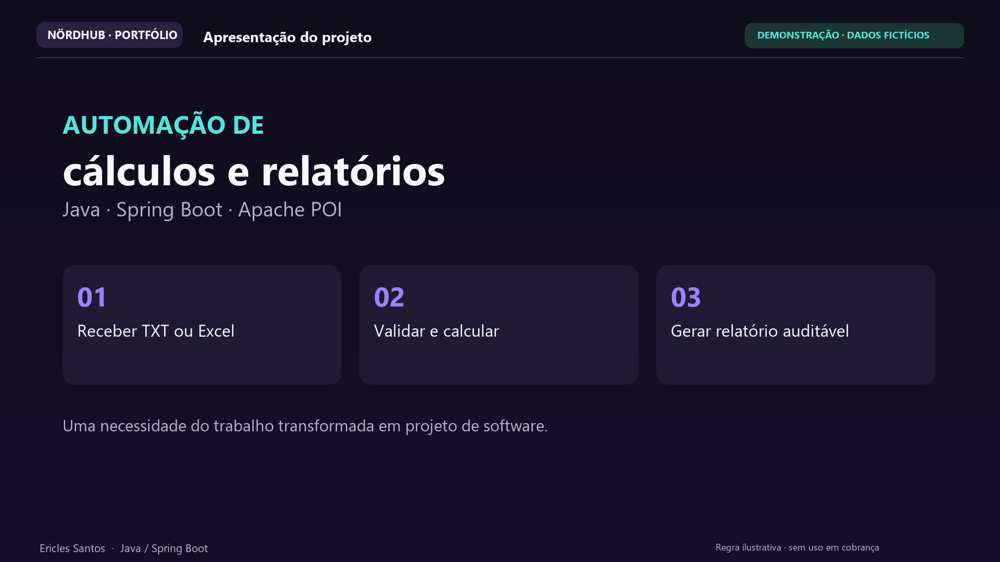
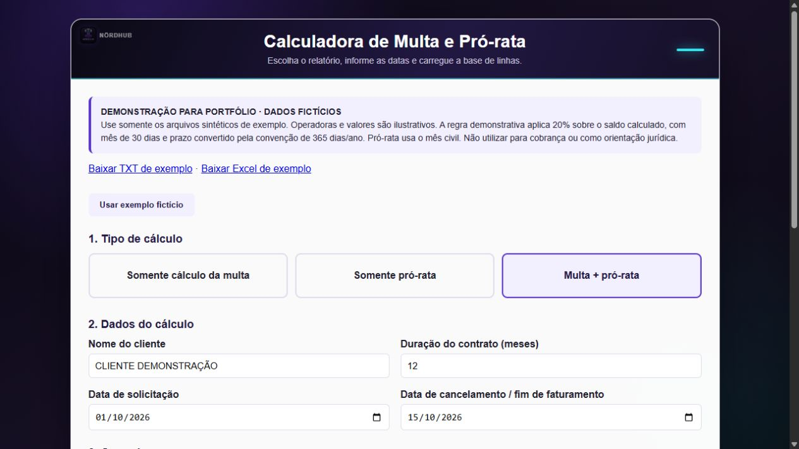
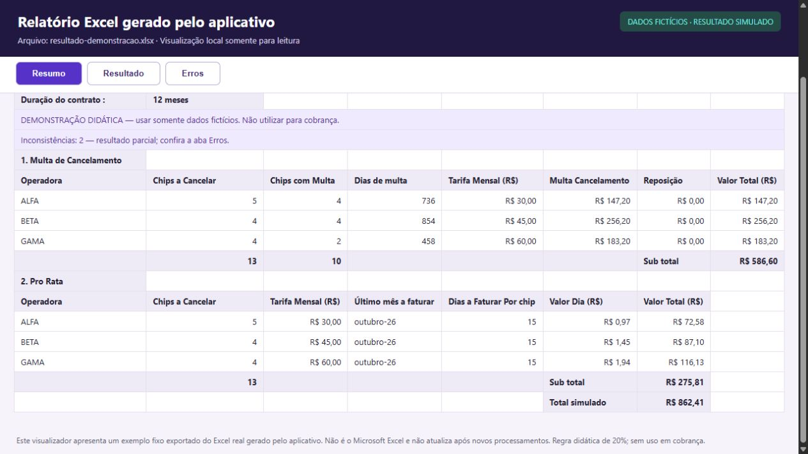
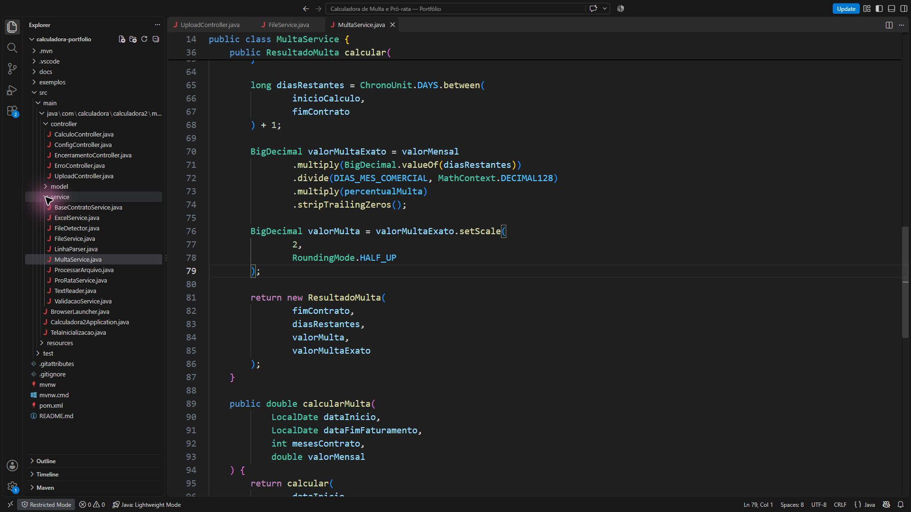

# Calculadora de multa e pró-rata — edição de portfólio

Aplicação local em Java 17 e Spring Boot que recebe arquivos TXT, CSV, XLS ou XLSX, valida registros e gera um Excel com as abas **Resumo**, **Resultado** e **Erros**.

Desenvolvi este projeto por iniciativa própria, inspirado em uma dificuldade da rotina de logística, durante minha preparação para migrar para a área de desenvolvimento. A proposta é automatizar uma conferência feita manualmente em planilhas. O foco é o processamento no backend: receber o arquivo, validar os registros, aplicar os cálculos e entregar um relatório que permita conferir o resultado.

**Edição de portfólio com dados fictícios e regra didática.** A base embutida contém apenas três registros sintéticos. Os arquivos de exemplo, identificadores, operadoras e valores demonstrados são fictícios.

## Demonstração em vídeo

[](https://github.com/EriclesSantos/calculadora-multa-pro-rata/releases/download/v1.0.0/calculadora-linkedin-refinado.mp4)

**Duração: aproximadamente 4min31s · Full HD · legendas em português · música de fundo em volume baixo.**

Clique na capa para baixar a demonstração em MP4. O vídeo apresenta a organização do projeto no VS Code, o código do cálculo e os resultados gerados com dados fictícios.

| Momento | Conteúdo |
| --- | --- |
| 01:05 | Estrutura do projeto: controllers, services e templates |
| 02:33 | Código do cálculo proporcional no MultaService |
| 03:09 | Relatório: resumo, resultados por registro e inconsistências |

**[Baixar o vídeo completo](https://github.com/EriclesSantos/calculadora-multa-pro-rata/releases/download/v1.0.0/calculadora-linkedin-refinado.mp4)** · **[Baixar o aplicativo em JAR](https://github.com/EriclesSantos/calculadora-multa-pro-rata/releases/download/v1.0.0/calculadora-portfolio.jar)** · [Como executar](#baixar-o-aplicativo)

## Tecnologias

| Tecnologia | Uso no projeto |
| --- | --- |
| Java 17 | Processamento dos registros, datas e cálculos com BigDecimal |
| Spring Boot 3.5.4 | Aplicação web local e endpoints de processamento |
| Maven / Maven Wrapper | Dependências, testes e empacotamento |
| Apache POI | Leitura de XLS/XLSX e geração do relatório Excel |
| Thymeleaf, HTML, CSS e JavaScript | Formulário, parâmetros e mensagens de processamento |
| JUnit 5 e Spring Test | Testes de cálculo, leitura, validação e ciclo da aplicação |

## Funcionalidades

- Importação de TXT, CSV, XLS e XLSX.
- Cálculo de multa, pró-rata ou dos dois no mesmo processamento.
- Validação de identificadores, operadoras e datas; indicação de resultados pendentes.
- Relatório com resumo por operadora, detalhamento por registro e inconsistências.
- Cenário fictício disponível no próprio formulário para reproduzir a demonstração.
- Execução local, com servidor vinculado a `127.0.0.1`.

Histórico em banco de dados, dashboard e exportação em PDF são **próximos passos**, ainda não implementados.

## Baixar o aplicativo

O aplicativo está pronto para testar, sem precisar compilar o projeto. Requisito: **Java 17 ou superior instalado**.

- **[Baixar o JAR executável](https://github.com/EriclesSantos/calculadora-multa-pro-rata/releases/download/v1.0.0/calculadora-portfolio.jar)** — aproximadamente 43 MB.
- **[Baixar o pacote para Windows](https://github.com/EriclesSantos/calculadora-multa-pro-rata/releases/download/v1.0.0/calculadora-portfolio-aplicativo.zip)** — contém o mesmo JAR e o iniciador `iniciar-calculadora.cmd`. Extraia o ZIP completo antes de abrir o iniciador.
- [Ver todos os arquivos da release v1.0.0](https://github.com/EriclesSantos/calculadora-multa-pro-rata/releases/tag/v1.0.0).

Para usar o JAR diretamente, abra o terminal na pasta em que ele foi salvo e execute:

```powershell
java -jar calculadora-portfolio.jar --calculadora.browser.auto-open=true
```

A aplicação inicia um servidor local e abre o navegador. Se a abertura automática não funcionar, acesse `http://127.0.0.1:48271/`. Clique em **Usar exemplo fictício** para experimentar o fluxo completo, usando os dados sintéticos fornecidos.

O [SHA-256 do JAR](https://github.com/EriclesSantos/calculadora-multa-pro-rata/releases/download/v1.0.0/calculadora-portfolio.jar.sha256) e os hashes dos pacotes estão disponíveis na release. Esta é uma demonstração com regra didática; não utilizar para cobrança.

O código também pode ser compilado seguindo as instruções abaixo.

## Aplicativo e resultados

Formulário do aplicativo em execução, com o cenário de demonstração carregado:



Resumo dos cálculos efetivamente gerados no arquivo Excel:



As capturas do formulário e da confirmação de processamento são do aplicativo aberto. As capturas das abas do relatório são de um visualizador local somente para leitura, alimentado pelo Excel gerado; não são da interface do Microsoft Excel. O visualizador representa esse exemplo fixo.

Veja as [capturas com suas descrições](docs/CAPTURAS.md), o [visualizador do exemplo](docs/relatorio-demonstracao.html) e o [arquivo Excel de resultado](exemplos/resultado-demonstracao.xlsx). Para abrir o visualizador, baixe o projeto e abra o HTML no navegador.

## Organização do código

```text
src/main/java/com/calculadora/calculadora2/multa/
  controller/  Recebimento dos parâmetros, upload e respostas HTTP
  service/     Leitura, validação, cálculo e geração do Excel
  model/       Tipos de cálculo, registros e resumos
src/main/resources/
  templates/   Páginas Thymeleaf
  static/      Recursos visuais e exemplos sintéticos
src/test/      Testes automatizados
exemplos/      Entradas fictícias e resultado gerado
docs/          Capturas e visualizador do relatório
```

O fluxo principal passa por `UploadController`, `FileService`, `MultaService`/`ProRataService` e `ExcelService`. O percentual didático fica explícito na configuração, separado da entrada do arquivo.

Trecho do cálculo na aplicação aberta no VS Code:



## Executar

Requisitos: Java 17 ou superior e Maven, ou o Maven Wrapper incluído. No PowerShell:

```powershell
mvn.cmd test
mvn.cmd package
java -jar target/calculadora2-0.0.1-SNAPSHOT.jar
```

Abra `http://127.0.0.1:48271/`. O servidor é vinculado apenas ao computador local. O navegador não abre automaticamente por padrão; para habilitar:

```powershell
java -jar target/calculadora2-0.0.1-SNAPSHOT.jar --calculadora.browser.auto-open=true
```

Também é possível usar `mvnw.cmd` no lugar de `mvn.cmd`. A primeira execução do Maven pode precisar baixar dependências.

## Reproduzir a demonstração

1. Clique em **Usar exemplo fictício**. O aplicativo carrega o TXT sintético e as datas.
2. Escolha **Multa + pró-rata** para conferir os dois cálculos.
3. Mantenha ALFA = R$ 30,00, BETA = R$ 45,00 e GAMA = R$ 60,00; solicitação em 01/10/2026, cancelamento em 15/10/2026 e prazo de 12 meses.
4. Os dias de pró-rata sugeridos são 15 para cada operadora.
5. Clique em **Processar e baixar Excel**.

Os arquivos de entrada e um resultado efetivamente gerado estão em `exemplos/`. Há 12 registros completos e duas inconsistências propositais: operadora desconhecida e data impossível. O registro com data pendente ainda é contado no pró-rata, mas sua multa fica marcada como **PENDENTE**. O resumo informa que o resultado é parcial.

Com esse cenário, a multa simulada é R$ 586,60, o pró-rata é R$ 275,81 e o total exibido é R$ 862,41. Os cálculos intermediários preservam precisão e o Excel exibe moeda com duas casas; o arredondamento ocorre após a agregação.

## Regra didática desta edição

- Percentual configurável em `application.properties`: `calculadora.multa.percentual=0.20`.
- Saldo proporcional: tarifa mensal × dias restantes ÷ 30.
- Multa simulada: saldo proporcional × percentual configurado.
- Prazo convertido pela convenção já existente no projeto: piso de 365 × meses ÷ 12 dias.
- O cálculo começa no dia seguinte ao cancelamento/fim de faturamento informado.
- Pró-rata: tarifa mensal ÷ dias reais do mês civil × linhas reconhecidas × dias informados.

O percentual de 20%, os valores e a convenção de cálculo são exemplos para demonstrar a implementação. **Não representam uma validação jurídica, uma fórmula universal de telecomunicações ou autorização para cobrança.** Esta edição substitui as condições comerciais vinculadas à empresa por um cenário didático.

## Cuidados da edição de portfólio

- Remoção da base real embutida e dos identificadores de clientes usados nos testes.
- Operadoras e tarifas fictícias no formulário; arquivos sintéticos disponíveis no próprio aplicativo.
- Aviso de demonstração no aplicativo e no Excel.
- Validação estrita de datas, para que datas como 31/02 não sejam ajustadas silenciosamente pelo calendário.
- Marcação de multa pendente e aviso de resultado parcial quando falta uma data válida.
- Respostas de entrada inválida com HTTP 400 e mensagens legíveis na página.
- Remoção de logs que exibiam cliente, nome de arquivo e condições comerciais.
- Remoção do Excel temporário após o fechamento do download.

O cálculo usa a data de cancelamento informada. Esse comportamento está coberto por testes.

## Validação realizada

Em 24/10/2026, no Windows, com JDK 25 compilando para Java 17:

- 22 testes passaram, sem falhas e sem testes ignorados.
- `mvn.cmd package` gerou o JAR executável.
- O JAR foi iniciado localmente e o formulário foi usado para carregar e processar o exemplo.
- Os três modos retornaram Excel por HTTP; a entrada XLSX também foi processada.
- Data de cancelamento anterior à solicitação e extensão inválida retornaram HTTP 400.
- Um lote com 10.000 registros sintéticos produziu 10.000 resultados sem inconsistências em uma execução local. Isso não é um benchmark nem uma promessa de tempo para outros ambientes.

O código, os recursos e os exemplos desta entrega foram comparados com os identificadores da base original para conferir sua remoção. Essa verificação não é uma auditoria completa de segurança, de licenças ou dos contratos de trabalho.

## Autor

Desenvolvido por [Ericles Santos](https://github.com/EriclesSantos), com foco em backend Java e automação de processos. Esta publicação apresenta um cenário demonstrativo para estudo e portfólio.
