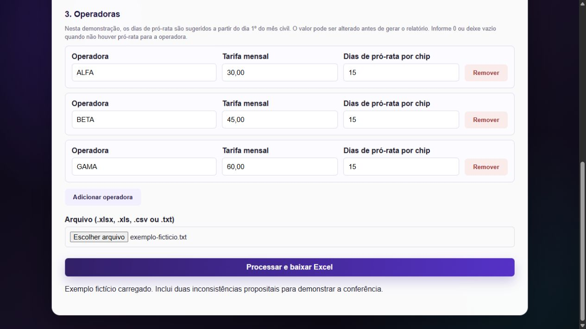
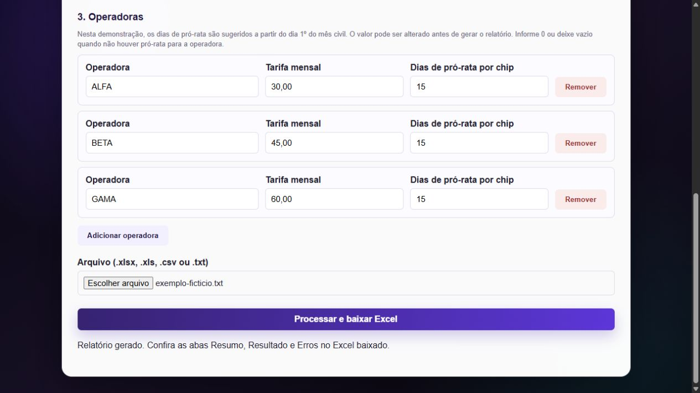
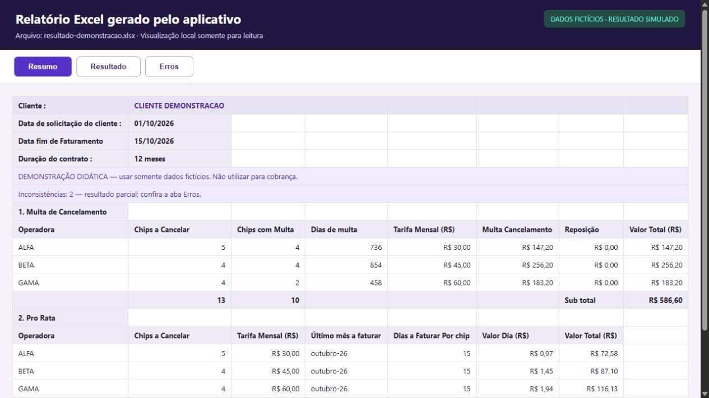
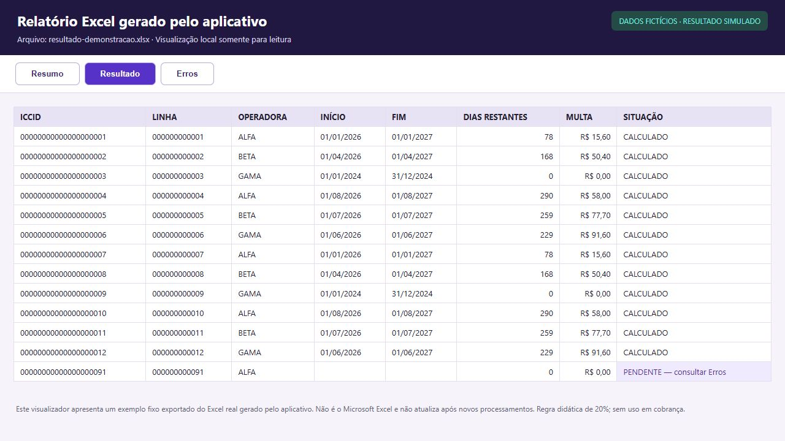
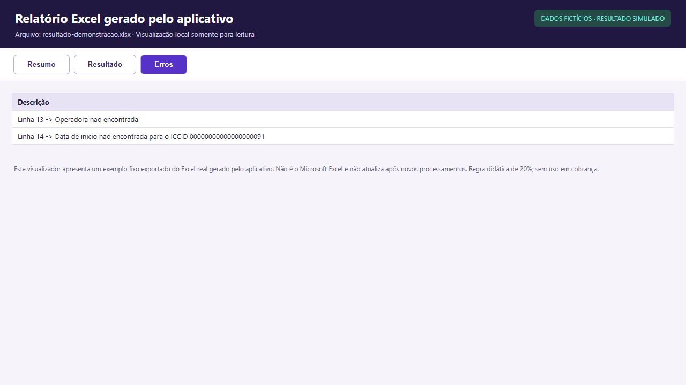
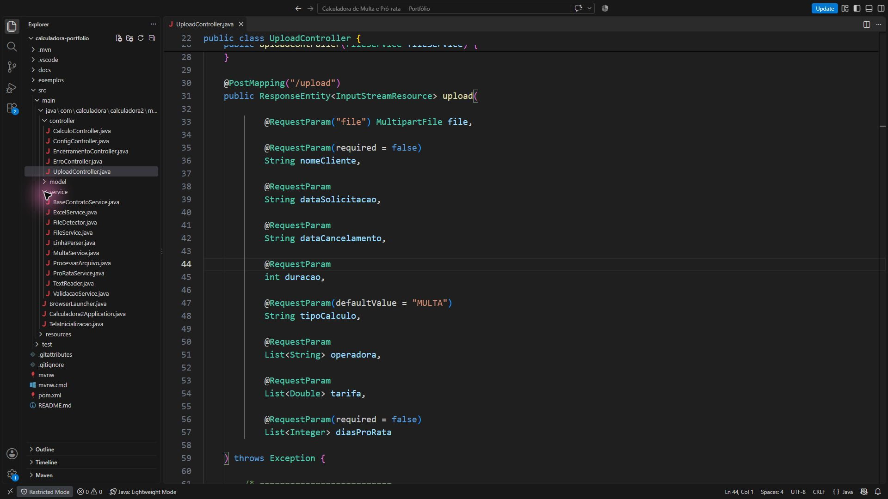
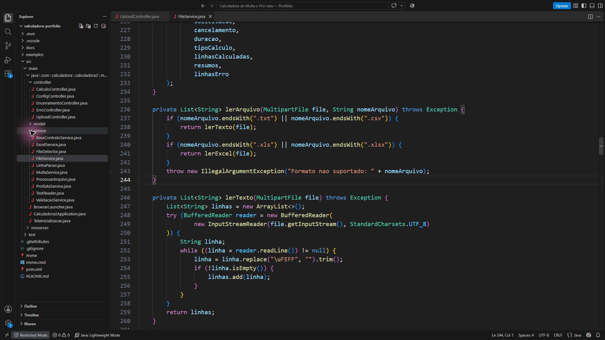

# Capturas da demonstração

Todas as imagens usam dados sintéticos. As três primeiras são capturas do aplicativo em execução. As imagens 4 a 7 são capturas de uma visualização local dos dados extraídos do arquivo `exemplos/resultado-demonstracao.xlsx`, efetivamente gerado pelo aplicativo. Esse visualizador não é o Microsoft Excel e mostra um exemplo fixo. As imagens 8 a 10 são capturas do código da edição demonstrativa aberto no VS Code.

## 1. Formulário e parâmetros

Aviso de demonstração, datas preenchidas e escolha do tipo de cálculo.

## 2. Operadoras e arquivo de entrada

Operadoras ALFA, BETA e GAMA, tarifas fictícias e TXT sintético selecionado.

## 3. Processamento concluído

Confirmação exibida pelo aplicativo após o download do relatório.

## 4. Resumo da multa

Quantidades e valores por operadora, com aviso de resultado parcial.

## 5. Pró-rata e total

Multa de R$ 586,60, pró-rata de R$ 275,81 e total simulado de R$ 862,41.

## 6. Resultados por linha

Identificadores fictícios, datas, dias restantes, valores e uma linha com situação pendente.

## 7. Inconsistências

Exemplos propositais de operadora desconhecida e data inválida para demonstrar a conferência.

## 8. Upload no backend

Controller que recebe o arquivo e os parâmetros do formulário.

## 9. Cálculo proporcional

Dias restantes, valor mensal, divisão por 30 e aplicação do percentual didático.

## 10. Leitura dos formatos

FileService identificando os formatos de entrada e iniciando a leitura.

